# Annotation Guide: Multi-Label Decision Tree for Workflow Weaknesses

This guide is the annotation procedure used for the WAVES labels. The labeling helpers in
[`scripts/helpers/detectors`](../scripts/helpers/detectors) implement it; the field definitions of the released files are in
[`data_dictionary.md`](data_dictionary.md) and the overall procedure is in [`methodology.md`](methodology.md).

# Multi-Label Decision Tree for Workflow Vulnerability Classification

## Approach

Each workflow is evaluated against **all 10 weakness checks independently**. A workflow receives every label whose condition is satisfied, there is no early exit. This reflects the reality that a single workflow can exhibit multiple distinct vulnerabilities simultaneously.

Nine checks are decided from the workflow text. **KVCW (Check 4) is not**: it is
decided by looking each referenced action up in the vulnerable-action inventory,
which is built before labeling begins by scanning every action reachable from the
corpus, directly or transitively. The inventory covers third-party actions only;
the well-known first-party namespaces `actions/*` and `github/*` were
deliberately skipped.

An action is in the inventory for a recorded **reason**. Every reason yields KVCW
except runner compatibility, which does not, because GRCW (Check 9) already names
that consequence. GRCW is evaluated independently and over all referenced
actions, first-party included.

## Overview Diagram

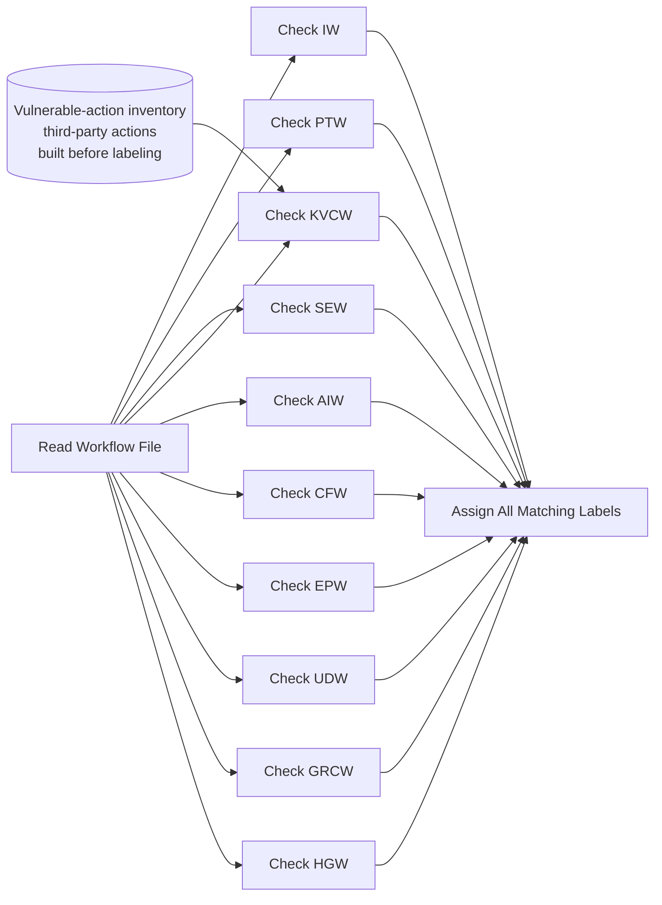

---

## Check 1: Injection Weakness (IW)

Injection risks such as unsafe uses of untrusted inputs within shell or JavaScript contexts or environment variables in CI workflows allow attackers to execute arbitrary code by manipulating such inputs. They can inject commands through pull request metadata or workflow inputs, leading to code execution, data exfiltration, or alteration of pipeline behavior. (Fares et al., 2026)

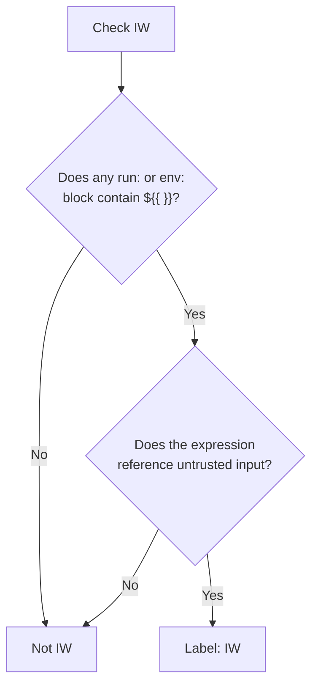

**Untrusted inputs (expanded in `run:` or `env:`):**
- `github.event.pull_request.title`, `.body`, `.head.ref`, `.head.repo.full_name`
- `github.event.issue.title`, `.body`
- `github.event.comment.body`
- `github.event.discussion.title`, `.body`
- `github.event.pages.*.page_name`
- `github.head_ref`
- `inputs.*` from `workflow_dispatch`
- `inputs.*` from `workflow_call` (if caller passes user-controlled data)

**Safe patterns (NOT IW):**
- `${{ github.workspace }}`, `${{ runner.os }}`, `${{ matrix.* }}` — runner/workflow-controlled
- Values set via `env:` block and referenced as `$VAR` in shell (environment variable indirection)
- `${{ steps.*.outputs.* }}` from trusted actions with validated outputs
- `${{ secrets.* }}` — not user-controlled (though may raise SEW concerns)

---

## Check 2: Privileged Trigger Weakness (PTW)

Some workflows are triggered by events that run in a trusted, base repository context, such as `pull_request_target` and issue or comment-driven automation. This means that users who do not have write access on the repository can still pass inputs (e.g., the name of an issue) to a workflow that runs with write-access privileges. A workflow that combines one of these triggers with instructions that process untrusted data or code paths turns into a serious risk. If the workflow checks out or executes PR-controlled code, or uses event fields in scripts, it can enable secret exfiltration or repository modification. (Fares et al., 2026)

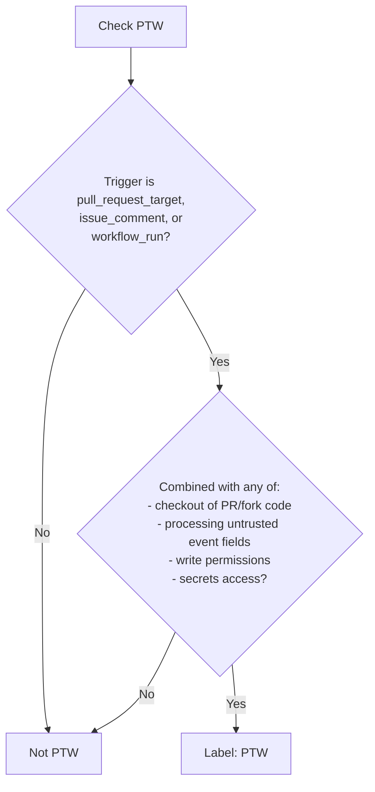

**Dangerous combinations:**
- `pull_request_target` + `actions/checkout` with `ref: ${{ github.event.pull_request.head.sha }}`
- `issue_comment` + write permissions + `secrets: inherit` or secret-using steps
- `workflow_run` + checkout of the triggering PR's head ref

**NOT PTW:**
- `pull_request_target` that only reads metadata without checking out PR code
- `issue_comment` with `permissions: {}` and no secret access

---

## Check 3: Secrets Exposure Weakness (SEW)

When sensitive credentials in workflows are not properly scoped or protected — such as hardcoded secrets, unnecessary exposure, or unsafe propagation across jobs — attackers can intercept them through log output, injected commands, or untrusted jobs. Leaked tokens, API keys, or credentials can be used to pivot into external infrastructure, spoof maintainers, or extract sensitive data, often without triggering immediate alarms in the CI environment. (Fares et al., 2026)

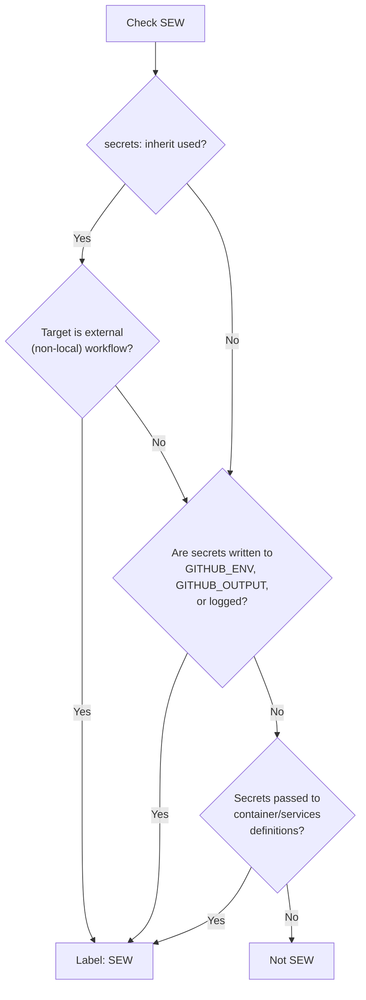

**Indicators:**
- `secrets: inherit` with `uses: org/repo/.github/workflows/...@ref` (external)
- `echo "${{ secrets.TOKEN }}" >> $GITHUB_ENV`
- Secrets expanded in `run:` steps that pipe to files or stdout
- Secret values passed to container `env:` or services definitions

**NOT SEW:**
- `secrets: inherit` to a local workflow (`./.github/workflows/...`)
- Secrets passed as `with:` parameters to trusted pinned actions (normal usage)

---

## Check 4: Known Vulnerable Component Weakness (KVCW)

Workflows that reuse and rely on components or actions with known vulnerabilities may expose the CI pipeline to existing exploits. An adversary can leverage these unpatched weaknesses to hijack execution, gain unauthorized access, or execute arbitrary code, especially in environments where updates are not regularly enforced. (Fares et al., 2026)

KVCW is **not** decided by reading the workflow. It is decided by looking the
referenced action up in the vulnerable-action inventory
([`kvcw_action_inventory.csv`](../data/inventories/kvcw_action_inventory.csv),
backed by the per-finding rows in
[`vulnerable_actions.csv`](../data/inventories/vulnerable_actions.csv); see
[`kvcw_inventory.md`](kvcw_inventory.md)), which was built
before labeling started by scanning every action reachable from the sampled
workflows, directly or transitively. The scan covered third-party actions only;
`actions/*` and `github/*` were skipped, so they never produce a KVCW label.

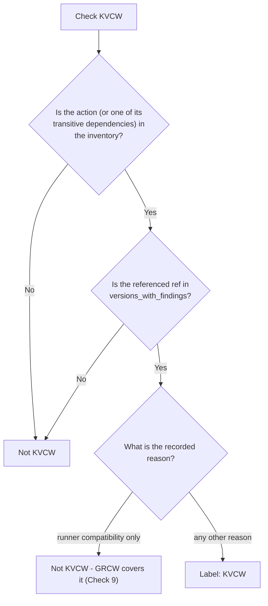

**The rule.** An action is in the list for a reason, and the reason decides
whether KVCW applies:

| recorded reason (`categories`) | KVCW? |
| --- | --- |
| `input_injection`, `known_cve`, `unsafe_cred_handling`, `network_exfil`, `insecure_download` | yes |
| `deprecated_runtime` only | no — this is what GRCW is for |
| a runtime reason **and** a non-runtime reason | yes, on the strength of the non-runtime reason |

Rationale: a deprecated runtime makes the step fail or be skipped, whereas the
other reasons hand an attacker a capability. Since GRCW already names the first
consequence, we do not also call it a known-vulnerable component. Four of the 60
flagged actions carry both kinds of reason (`docker/build-push-action`,
`cla-assistant/github-action`, `atlassian/gajira-create`,
`LouisBrunner/checks-action`); they are KVCW, and GRCW picks them up separately.

**How to verify:**
- Match `uses: owner/repo@ref` against the `action` column of `kvcw_action_inventory.csv`
- Confirm the `ref` appears in `versions_with_findings` for that entry; a hit on
  the action but not the version is **not** a label
- Read `categories` and apply the table above
- `kvcw_reason` records whether the hit is `direct`, `transitive`, or `both`;
  record the dependency path for transitive hits
- Where the entry carries a CVE, `vulnerable_version_ranges` further constrains
  the affected refs

---

## Check 5: Artifact Integrity Weakness (AIW)

GitHub Actions Workflows that do not validate the integrity of artifacts or reused dependencies are vulnerable to supply chain attacks. Malicious actors can poison caches or inject backdoored artifacts into later stages of the pipeline, leading to compromised artifacts or lateral movement into trusted systems. (Fares et al., 2026)

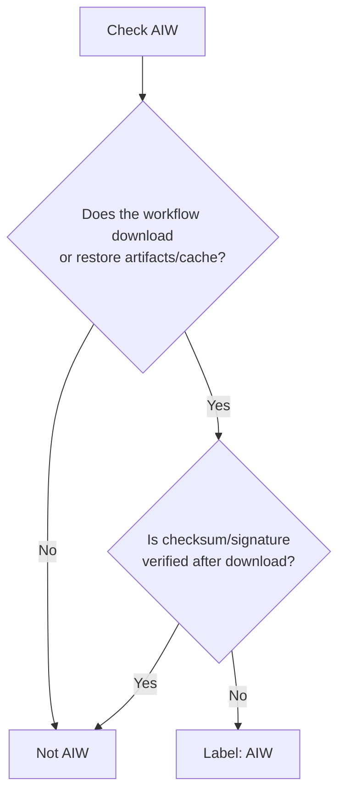

**Indicators:**
- `actions/download-artifact` without subsequent hash verification
- `actions/cache` restore in PR-triggered workflow (cache poisoning risk)
- `wget`/`curl` downloading binaries without checksum validation
- Consuming outputs from prior workflow runs without attestation

---

## Check 6: Control Flow Weakness (CFW)

In GitHub Actions Workflows, developers use conditions to control when specific steps should be executed. However, attackers can exploit flawed conditions — such as ones that are always true (overly permissive) — to bypass intended safeguards. This may lead to the unauthorized execution of sensitive jobs, including deployments or access to secrets. (Fares et al., 2026)

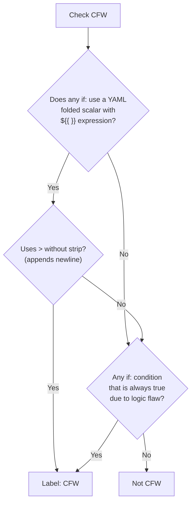

**Key patterns:**
- `if: >` with `${{ boolean_expr }}` — the `>` appends `\n`, making `"false\n"` truthy
- `if: >-` is safer (strips trailing newline) but can still have logic errors
- Any condition that logically always evaluates to true (dead code)

---

## Check 7: Excessive Permission Weakness (EPW)

Overprivileged workflows, tokens, jobs, or permissions create opportunities for privilege escalation attacks. If a workflow does not explicitly restrict its `GITHUB_TOKEN` permissions, an attacker who gains control of a job via injection or logic flaws can abuse broad permissions to push code, access secrets, or modify critical repository settings. (Fares et al., 2026)

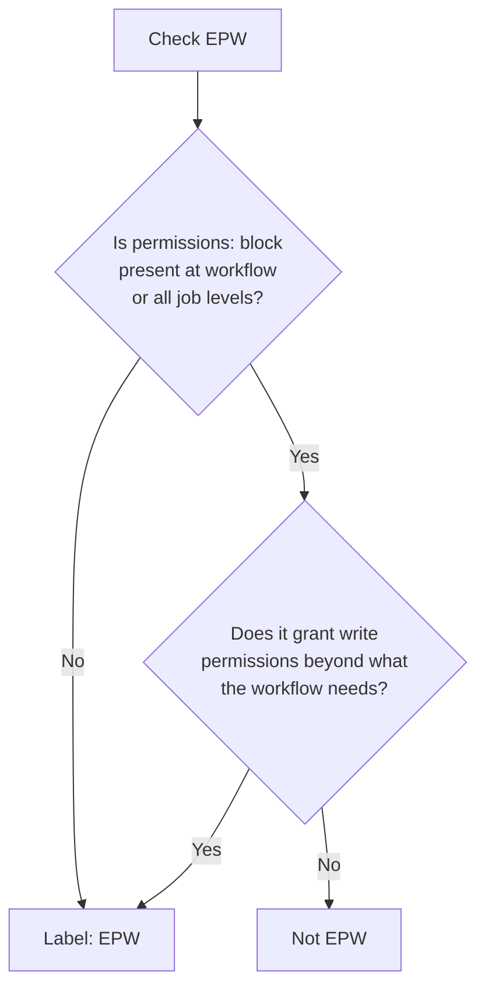

**Indicators:**
- No `permissions:` key at either workflow-level or job-level (defaults to broad)
- `permissions: write-all`
- `contents: write` when the workflow only reads code
- `pull-requests: write` + `contents: write` + `id-token: write` for simple automation

**NOT EPW:**
- `permissions: contents: read` (explicit minimal)
- `permissions: {}` (no permissions)
- Write permissions that match the workflow's actual function (e.g., `issues: write` for issue-labeling workflow)

---

## Check 8: Unpinned Dependency Weakness (UDW)

The absence of pinned versioning for actions or dependencies exposes workflows to substitution attacks, where an adversary introduces malicious updates into upstream components. By exploiting floating tags or unverified references, attackers can inject backdoors or tampered logic into workflows without any change in the workflow's own source code, making the attack stealthy and persistent. (Fares et al., 2026)

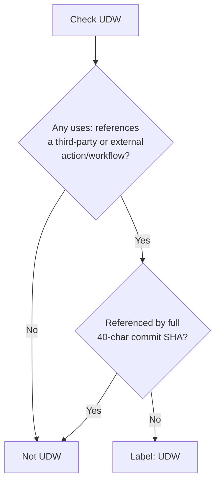

**Unpinned (vulnerable):**
- `uses: owner/action@main` — branch (mutable, can be force-pushed)
- `uses: owner/action@v4` — major tag (can be moved to any commit)
- `uses: owner/action@v1.2.3` — semver tag (can be deleted and recreated)
- `uses: owner/action@branch-25.08` — branch name

**Pinned (safe):**
- `uses: owner/action@a1b2c3d4e5f6789...` — 40-char SHA (immutable)

**NOT UDW:**
- Local actions: `uses: ./.github/actions/my-action` (same repo, same commit)
- Local workflows: `uses: ./.github/workflows/reusable.yml` (same repo)

---

## Check 9: GitHub Runner Compatibility Weakness (GRCW)

This weakness occurs when a workflow references an action, runtime, or workflow construct that cannot be reliably resolved, interpreted, or supported in the current GitHub Actions environment. Common root causes include outdated major versions of actions that rely on deprecated language runtimes, as well as unrecognized or renamed workflow keys, contexts, or expressions that do not resolve under the GitHub Actions specification. These incompatibilities can cause jobs to fail or be skipped, unintentionally disabling required checks or security steps. (Fares et al., 2026)

GRCW is evaluated over **all** referenced actions, first-party included, so it is
not scoped by the inventory. Where the inventory does record a
`deprecated_runtime` reason for a third-party action, that is corroborating
evidence for GRCW and the signal that KVCW is withheld (Check 4).

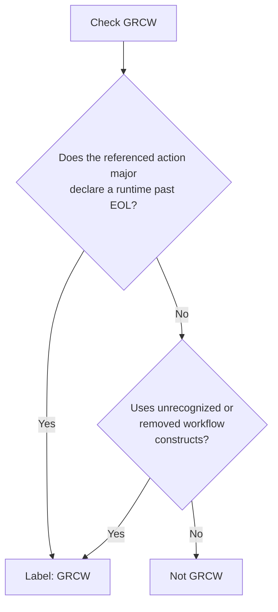

**Deprecated runtimes:**
- Node.js 12 (EOL April 2022): `actions/checkout@v2`, `actions/setup-python@v2`, `actions/setup-node@v2`
- Node.js 16 (EOL September 2023): `actions/checkout@v3`, `actions/setup-node@v3`

For third-party actions, cross-check `kvcw_actions.csv` so the version constraint
is applied consistently; for `actions/*` and `github/*` the inventory is silent by
design and this table is the whole procedure.

**Other indicators** (decided from the workflow text, no inventory involved):
- Removed workflow commands: `::set-output`, `::save-state`
- Unsupported `runs-on` labels

---

## Check 10: Hardening Gap Weakness (HGW)

Workflows that lack integrated security scanning tools (e.g., SAST, dependency auditing, or secret scanning) create a hardening gap, giving attackers a broader surface to operate undetected. Without static analysis, dependency updates, or review enforcement, adversaries can introduce vulnerable code, exploit unpatched components, or suppress controls that would otherwise expose their actions. (Fares et al., 2026)

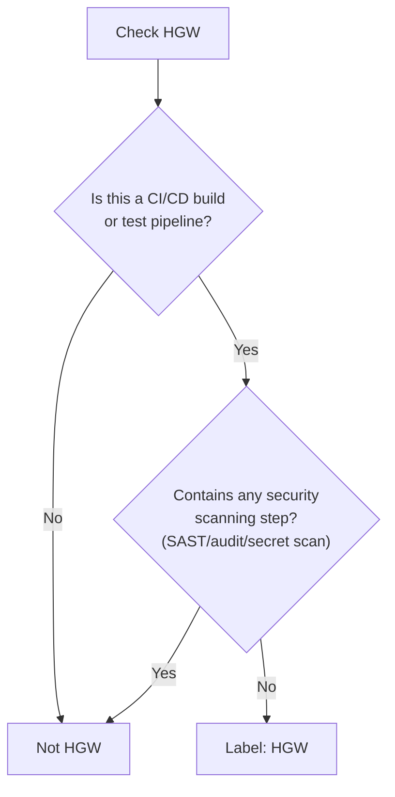

**Applies to workflows that:**
- Execute builds (`mvn install`, `npm run build`, `make`, `cargo build`)
- Run tests (`pytest`, `jest`, `bundle exec rake spec`)
- Package/deploy artifacts

**Does NOT apply to:**
- Issue/PR automation (assignment, labeling, stale cleanup)
- Notification workflows
- Workflows that solely delegate to reusable workflows (cannot inspect their content)

**Security scanning examples:**
- CodeQL / `github/codeql-action`
- Dependency review / `actions/dependency-review-action`
- Trivy, Snyk, Dependabot
- Secret scanning / ggshield
