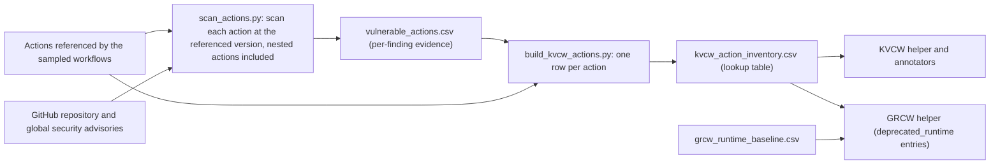

# The Action Inventories (KVCW and GRCW)

Two weakness categories depend on information about the actions a workflow references, not just on the workflow text:
Known-Vulnerable-Component Weakness (KVCW) and GitHub-Runner-Compatibility Weakness (GRCW). The inventories in
[`data/inventories/`](../data/inventories) provide that information. This page explains how they were built and how
they differ.

## The two files

| | `vulnerable_actions.csv` | `kvcw_action_inventory.csv` |
|---|---|---|
| Role | Scan evidence | Decision table used for labeling |
| Granularity | One row per finding (action, version, pattern) | One row per action |
| Rows | 220 findings over 72 actions | 74 actions |
| Nesting | Parent action, depth and parent version per finding | Which parent versions nest a vulnerable child |
| Read by the helpers | No | Yes (`detectors/kvcw_index.py`) |

The inventory has 74 actions and the scan output 72 because two actions have no finding of their own: they are parents
that only nest a vulnerable action (`kvcw_reason = transitive`): `aio-libs/create-release@v1.6.6`, which nests
`pypa/gh-action-pypi-publish@v1.5.0` (paper Listing 3), and `cisagov/action-job-preamble@v1`, which nests
`crazy-max/ghaction-github-status@v4`. Their evidence is the child's rows in `vulnerable_actions.csv`.

## How they are built

1. **Scope.** Every third-party action referenced by the sampled workflows, plus every action reachable from them
   through nested `uses:` references (unlimited depth, with cycle detection). The first-party namespaces `actions/*`
   and `github/*` are not scanned, so they never produce a KVCW label.
2. **Scan** (`scripts/action_analysis/scan_actions.py`). Each action is inspected at the exact referenced version:
   - static patterns on the action source (JavaScript, composite and Docker actions) give `input_injection`,
     `network_exfil`, `unsafe_cred_handling` and `insecure_download` findings;
   - the `runs.using` field of `action.yml` gives `deprecated_runtime` findings;
   - GitHub repository and global security advisories give `known_cve` findings. The advisory's affected range is
     compared with the referenced version: `version_match = yes` (inside the range) or `unknown` (a SHA, a branch, or
     an unparseable or missing range) rows are kept, and `no` (clearly outside) rows are dropped.
3. **Aggregate** (`scripts/action_analysis/build_kvcw_actions.py`). One row per action, with the reason it is listed.
   For parents that nest a vulnerable action, the parent and child tags are resolved to commit SHAs with the GitHub API.
4. **Manual review.** Candidate entries were manually reviewed before being used to assign labels.

## `vulnerable_actions.csv`

| Column | Description |
|---|---|
| `action`, `owner`, `repo`, `github_url` | The action containing the finding |
| `version` | Version (tag, branch or SHA) scanned |
| `vulnerability_category` | `input_injection` (high), `known_cve` (high), `network_exfil` (medium), `insecure_download` (medium), `unsafe_cred_handling` (low), `deprecated_runtime` (low) |
| `severity` | `high`, `medium`, `low` (default per category; advisory severity for CVEs) |
| `pattern_matched`, `file_path`, `evidence_snippet` | The pattern, the file in the action and the matching line |
| `cve_id`, `vulnerable_version_range`, `first_patched_version`, `version_match` | For `known_cve` rows: the advisory, its affected range, the fix, and whether the scanned version is inside the range (`yes`/`unknown`) |
| `usage_count`, `workflow_count` | Uses of the action across the sampled workflows |
| `parent_action`, `parent_version`, `depth`, `is_transitive` | For nested findings: the action that references this one and the nesting depth (0 = referenced directly by a workflow) |

Row counts: `input_injection` 120, `deprecated_runtime` 50, `known_cve` 28, `unsafe_cred_handling` 10,
`network_exfil` 9, `insecure_download` 3; 9 of the 220 rows are transitive (depth 1).

## `kvcw_action_inventory.csv`

| Column | Description |
|---|---|
| `action` | `owner/repo` (with a sub-path if the action lives in a subdirectory) |
| `kvcw_reason` | `direct` (70): the action itself has findings. `transitive` (2): only a nested action has findings. `both` (2): the action has its own findings and nests a vulnerable one |
| `via_vulnerable_action` | Nested vulnerable actions, separated by `;` (transitive and both) |
| `categories` | Distinct finding categories for the action, separated by `;` |
| `max_severity` | Highest severity among the findings |
| `finding_count` | Number of findings behind the entry |
| `versions_with_findings` | Versions that carry a finding; for transitive entries, the affected parent versions |
| `parent_versions_affected`, `nested_child_versions`, `nesting_edges` | Which parent versions nest which child versions, as `parent@version -> child@version` |
| `parent_resolved_shas`, `child_resolved_shas` | Commit SHAs of those tags, so a SHA-pinned reference to an affected version also matches |
| `cve_ids`, `vulnerable_version_ranges`, `first_patched_versions`, `version_matches` | Advisory data for `known_cve` findings |
| `notes` | Plain-language rule for the entry |

## How a workflow reference is matched

For each `uses: owner/repo@ref` of a workflow (local `./` references are skipped), the helper looks up `action`:

- **`direct`**: matches if `ref` is in `versions_with_findings`.
- **`transitive`**: matches if `ref` is in `parent_versions_affected` or equals one of `parent_resolved_shas`. Other
  versions of the same parent are **not** labeled.
- **`both`**: matches if either condition above holds.

A match yields a KVCW label unless the entry's `categories` are exactly `deprecated_runtime` (see below).

## KVCW versus GRCW

The `categories` of an entry decide which weakness applies (the annotation guide has the rationale, Check 4):

| `categories` | KVCW | GRCW |
|---|---|---|
| any of `input_injection`, `known_cve`, `unsafe_cred_handling`, `network_exfil`, `insecure_download` | yes | independent |
| `deprecated_runtime` only | no | yes |
| `deprecated_runtime` and one of the above | yes | yes |

34 of the 74 inventory entries have `deprecated_runtime` as their only category: they never produce a KVCW label and
feed GRCW only. The other 40 entries can produce KVCW labels (4 of them also carry `deprecated_runtime`).

GRCW also uses [`grcw_runtime_baseline.csv`](../data/inventories/grcw_runtime_baseline.csv), which lists the official
action major versions on deprecated Node.js runtimes (for example `actions/checkout@v3`) and the removed workflow
commands `::set-output` and `::save-state`. GRCW applies to all referenced actions, first-party included. The sources
of the baseline are in [`sources.csv`](../data/inventories/sources.csv).

## Caveats

- The inventories describe the actions referenced by the sampled workflows (the 500-workflow sample, a superset of the
  released real-world workflows) at the referenced versions. They are not a general database of vulnerable actions.
- Static pattern findings over-approximate flows and may miss equivalent formulations; mutable refs would need pinned
  snapshots to be stable.
- First-party actions (`actions/*`, `github/*`) are outside the KVCW inventory but inside GRCW.
