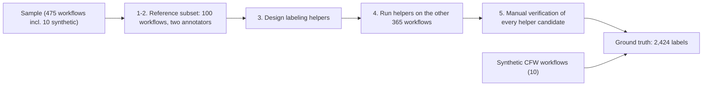

# Methodology

WAVES labels GitHub Actions workflows against the ten-weakness classification of Fares et al. (arXiv:2601.14455):
AIW, CFW, EPW, GRCW, HGW, IW, KVCW, PTW, SEW, UDW. A workflow may carry several categories (multi-label).
Every weakness instance is evidence-linked: it records the category, the line, the supporting evidence and a justification.

## 1-2. Reference subset (100 workflows)

A stratified random sample without replacement on structural complexity: 33 simple, 33 medium, 34 complex. Two
annotators independently labeled the workflows following the [annotation guide](annotation_guide.md), then
cross-labeled each other's workflows and adjudicated disagreements. Every workflow was evaluated against all ten
categories, so in this subset a missing label is a confirmed negative. The result is frozen:
[`data/reference_decisions.csv`](../data/reference_decisions.csv) (445 instances over 99 workflows; the remaining
workflow, `falcosecurity/falcosidekick` `lint.yml`, is a confirmed all-negative case).

## 3. Labeling helpers

The decision tree of each category is implemented as a script ([`scripts/helpers`](../scripts/helpers)). Helpers are
designed for the highest possible recall: they report candidate instances with location and evidence for manual
review and never assign final labels. They were refined on the reference subset until every category present in it
reached a recall of 1.0, without modifying the reference labels. Reproduce with
`python scripts/helpers/eval_helpers.py`.

KVCW and GRCW also use the version-aware inventories in [`data/inventories/`](../data/inventories): the KVCW inventory
is built from GitHub's repository and global security advisories and from inspecting each action's source at the exact
referenced version, including transitive actions; the GRCW baseline lists official action major versions on deprecated
Node.js runtimes and removed workflow commands. Candidate inventory entries were manually reviewed before use.

## 4-5. Helper run and manual verification

The helpers were run on the remaining 365 workflows and proposed 2,136 candidates. Reviewers examined every candidate
against the same criteria as the reference subset and kept 1,969 (rejected 167); see
[`data/helper_candidates.csv`](../data/helper_candidates.csv) and Table 3 in `results/tables/helper_candidates_by_type.csv`.
KVCW and GRCW candidates were all retained because the helpers used the same inventory and baseline as the annotators.
Workflows whose candidates were all rejected are retained as confirmed all-negative cases (7 of the 8).

## Synthetic CFW workflows

No CFW instance occurs in the real-world workflows. To let scanners be evaluated on all ten categories, ten synthetic
workflows each containing a manually confirmed CFW instance were added. They come from `sparkrew/cfw-benchmark` at commit
`8197fa5a873094fd584ebc82cfdae78c81a6d2e9` and are flagged `source_type = synthetic`. They characterize detection ability
for CFW and say nothing about CFW prevalence.

### How they were created

- **Model and date.** The workflows were generated with Anthropic Claude Sonnet 5 on 2026-09-05 (the benchmark commit
  is dated 2026-09-06, which is the `retrieval_date` of these workflows).
- **Role of the model.** The model proposed the workflows. Each workflow was reviewed manually against the CFW criterion
  of the [annotation guide](annotation_guide.md#check-6-control-flow-weakness-cfw), and the label in `labels.csv` points
  to the `if:` line that carries the weakness. The generation also produced a `labels.json` in `sparkrew/cfw-benchmark`
  that records the model's intended vulnerable location for each file. It is not part of WAVES.
- **Context given to the model.** The request was made in a conversation that started with the definition of CFW from
  Fares et al., including the folded-scalar example from `EbookFoundation/free-programming-books`. The model was then asked
  to check a few real workflows for CFW before the generation request.
- **Generation request** (edited for spelling and punctuation only):

  > I am creating a benchmark of vulnerable GitHub Actions workflows and I need 10 workflows that contain a CFW
  > (Control Flow Weakness) vulnerability. Please create them. I also want to publish them on GitHub, so structure the
  > repository and tell me what to do.

  The request contains no further specification. The variants were chosen by the model, with ten workflows requested and
  ten retained. The manual review is therefore what establishes that each file matches the criterion.
- **Patterns.** The file names in `workflows/synthetic/` describe the intended shape of each case: a classic folded
  scalar, a literal block scalar, a partially wrapped expression, a `workflow_run` fork check, a reusable-workflow gate,
  a step-level debug gate, a matrix condition, an approval-gate bypass, a release-branch gate, and a contrastive pair.
- **Content of the files.** Each file carries a header comment (`# VULNERABLE (CFW-nn): ...`) that names the weakness
  and explains it. The snapshots are kept exactly as committed. Scanners that read comments, for example LLM-based ones,
  therefore see the explanation, which static rule-based scanners do not use.

Because the cases were written to exhibit CFW, a scanner's result on them measures whether it detects these constructions,
not how it behaves on workflows found in the wild.

## Counting conventions

- UDW: one instance per `uses:` reference (action or reusable workflow) that is not pinned to a full commit SHA.
- IW: one instance per distinct combination of an untrusted input and a `run:` block.
- EPW: a missing `permissions:` block, `write-all`, or write permissions not justified by the workflow's function.
- Annotation granularity is workflow-level for EPW, HGW and PTW and site-level for the others.
