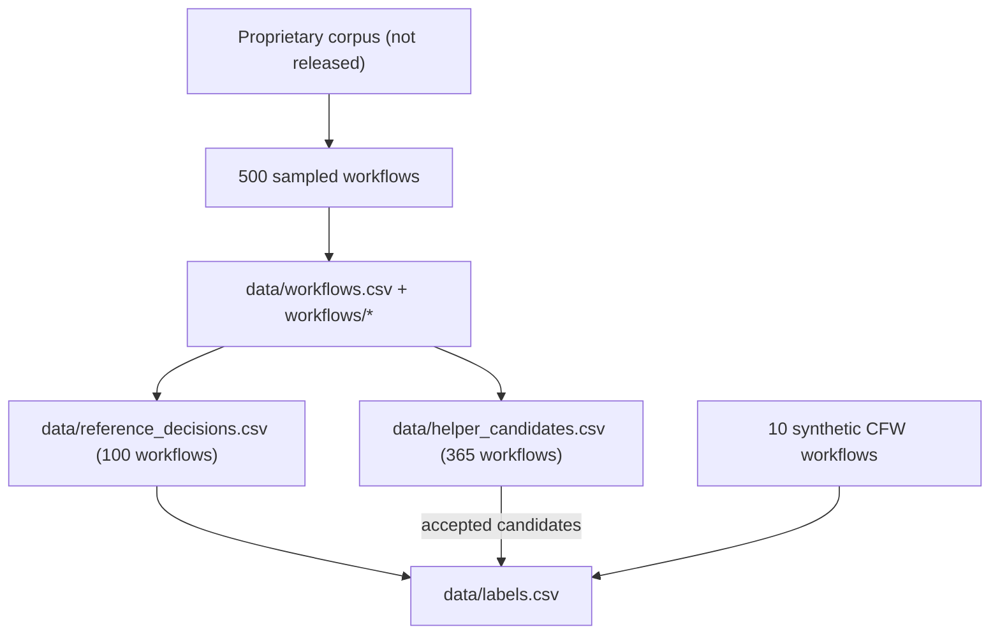

# Provenance

## Where the data comes from

| Item | Origin |
|---|---|
| Corpus | Proprietary corpus of 1,048,857 public GitHub Actions workflows maintained by Boost Security (not released). Only the sampled workflows are published, with their repository, path and commit. |
| Real-world workflows (465) | Sampled from that corpus (see [sampling.md](sampling.md)); file contents retrieved at the recorded commit, retrieval date 2026-06-10. |
| Synthetic workflows (10) | `sparkrew/cfw-benchmark` at commit `8197fa5a873094fd584ebc82cfdae78c81a6d2e9`, generated with an LLM and manually reviewed. `retrieval_date` is that commit's date. |
| Reference labels (445) | Two annotators, cross-labeling and adjudication on 100 workflows. |
| Helper candidates (2,136) | Output of the labeling helpers on 365 workflows; every candidate manually reviewed. |
| KVCW inventory, GRCW baseline | GitHub security advisories and runtime-deprecation notices; see `data/inventories/sources.csv`. |

## Lineage of the released tables

`labels.csv` is the union of the reference decisions, the accepted helper candidates and the ten synthetic CFW labels.
Each reference decision and each accepted candidate carries the `label_id` of its row in `labels.csv`, and
`scripts/validate_dataset.py` checks that these links are one-to-one and cover `labels.csv` exactly.

## Identifiers

`workflow_id` values (`WAVES-0001`...) were assigned in order: reference workflows, then helper-reviewed workflows, then
synthetic ones, each sorted by blob URL. `label_id`, `decision_id` and `candidate_id` are numbered by `workflow_id`
and then line number. The identifiers are stable across releases; new workflows receive new numbers.

## Snapshot integrity

`file_sha256` in `data/workflows.csv` and `workflows/checksums.sha256` fix the content of every snapshot.
`scripts/fetch_workflows.py --check` verifies that GitHub still serves the same bytes.
